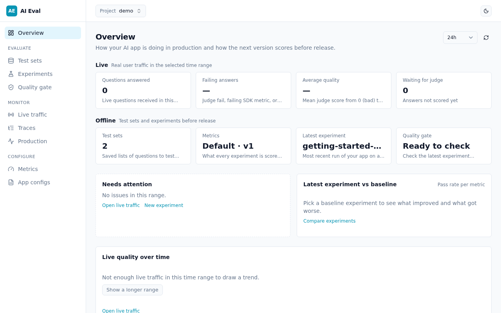
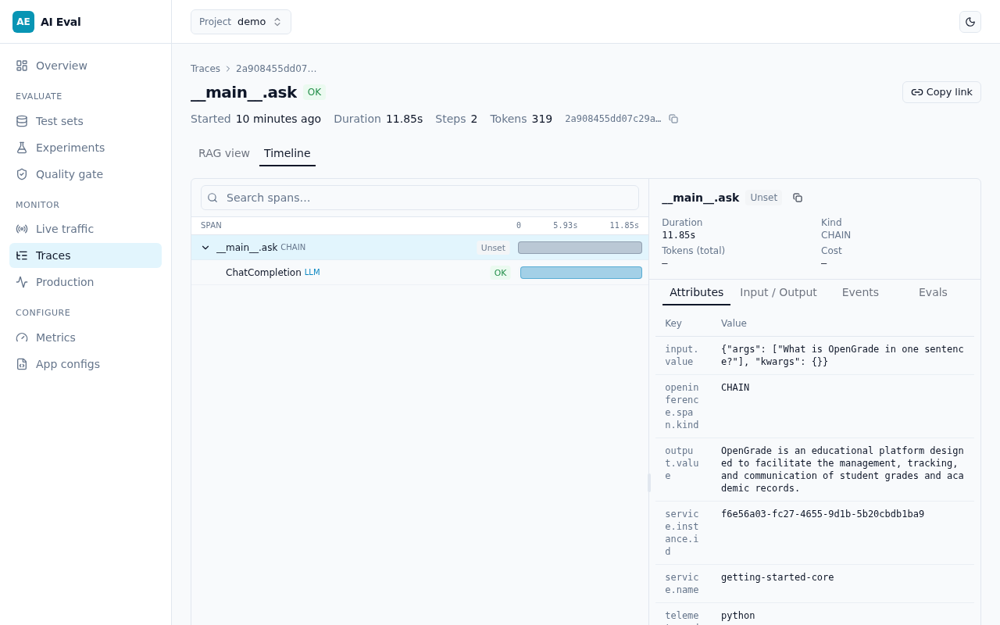
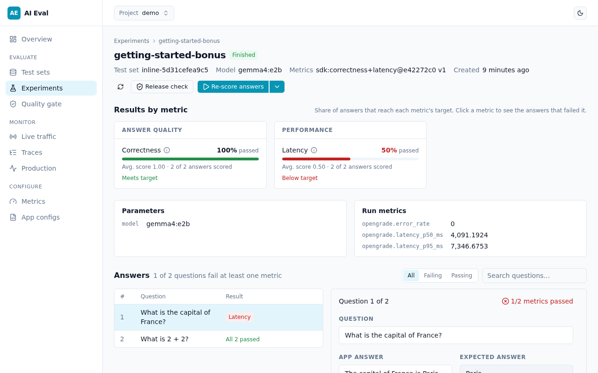

# Getting started in 15 minutes

OpenGrade is a self-hosted platform for AI quality engineering: instrument your app, inspect traces, run experiments on a test set, and gate releases.

This guide uses **`uv`** and **`opengrade ui`** (SQLite — no Docker).  
**Core (~10 min):** see a trace in the UI.  
**Bonus (~5 min, optional):** score a tiny experiment with an LLM judge.

## Prerequisites

- Python ≥ 3.12 and [`uv`](https://docs.astral.sh/uv/)
- A chat model:
  - **Ollama (default):** `ollama pull gemma4:e2b` (or set `OLLAMA_MODEL` to a model you have)
  - **Cloud:** set `OPENAI_BASE_URL`, `OPENAI_API_KEY`, and `OPENAI_MODEL` for the app scripts
- For Bonus judges: the same Ollama on localhost, **or** a cloud judge via `.env` next to where you run `opengrade ui`:

```bash
# Ollama judge (host)
LLM_MODEL=ollama/gemma4:e2b
LLM_API_BASE=http://localhost:11434

# Or cloud (example)
# LLM_MODEL=gemini/gemini-3.8-flash
# LLM_API_KEY=...
```

Without a reachable judge, traces still work; LLM metrics show as unavailable.

## Core — UI + first trace

### 1. Install

```bash
mkdir opengrade-demo && cd opengrade-demo
uv init --bare
uv add 'opengrade-ai[ui,openai]' openai
```

From this monorepo instead of PyPI (soft-launch / local wheels):

```bash
# repo root (Node/npm required for the UI bundle)
python3 scripts/package_ui.py
mkdir -p /tmp/opengrade-demo && cd /tmp/opengrade-demo
uv init --bare
uv add --editable /ABS/PATH/TO/ai_eval_platform/sdk --extra ui --extra openai
uv add openai
```

(`sdk` resolves `opengrade-ai-server` from the sibling `backend` via `uv` sources when editable.)

### 2. Start the UI

```bash
uv run opengrade ui
# http://127.0.0.1:8000  → creates ./opengrade.db
```

Leave it running. Open [http://127.0.0.1:8000](http://127.0.0.1:8000) — you should land on **Overview**.



### 3. Emit a trace

In a second terminal:

- **Demo project:** save the script below as `getting_started_core.py`, then `uv run python getting_started_core.py`.
- **From the OpenGrade repo** (with UI still reachable at `http://127.0.0.1:8000`):

```bash
uv run --directory sdk --with openai python ../scripts/getting_started_core.py
```

`getting_started_core.py`:

```python
"""Getting-started Core: one CHAIN + LLM child span → project demo."""

from __future__ import annotations

import os

from openai import OpenAI

import opengrade

opengrade.set_tracking_uri(os.getenv("OPENGRADE_TRACKING_URI", "http://127.0.0.1:8000"))
opengrade.set_project(os.getenv("OPENGRADE_PROJECT_SLUG", "demo"))
opengrade.init(service_name="getting-started-core", instrument="auto")

base = os.getenv("OPENAI_BASE_URL") or (
    os.getenv("OLLAMA_HOST", "http://127.0.0.1:11434") + "/v1"
)
client = OpenAI(base_url=base, api_key=os.getenv("OPENAI_API_KEY") or os.getenv("OLLAMA_API_KEY", "ollama"))
MODEL = os.getenv("OPENAI_MODEL") or os.getenv("OLLAMA_MODEL", "gemma4:e2b")


@opengrade.trace
def ask(q: str) -> str:
    r = client.chat.completions.create(
        model=MODEL,
        messages=[{"role": "user", "content": q}],
    )
    return r.choices[0].message.content or ""


def main() -> None:
    print(ask("What is OpenGrade in one sentence?"))
    opengrade.flush()
    print("Open Traces in the UI for project demo.")


if __name__ == "__main__":
    main()
```

### 4. Inspect in the UI

1. Select project **demo** in the project switcher if needed.
2. Open **Production → Traces** (Monitor section).
3. Open the latest trace — parent CHAIN + child LLM.



**Glossary (Core):** a **Project** is the workspace for your data; a **Trace** is the OTLP span tree for one request. Full glossary: [docs/README.md](README.md).

## Bonus — score a tiny experiment

Same venv and UI. Ensure the judge env above is set, then restart `opengrade ui` if you just added `.env`.

- **Demo project:** save the script below as `getting_started_bonus.py`, then `uv run python getting_started_bonus.py`.
- **From the OpenGrade repo** (with UI still reachable at `http://127.0.0.1:8000`):

```bash
uv run --directory sdk --with openai python ../scripts/getting_started_bonus.py
```

`getting_started_bonus.py`:

```python
"""Getting-started Bonus: inline dataset + evaluate → experiment URL."""

from __future__ import annotations

import os

from openai import OpenAI

import opengrade

opengrade.set_tracking_uri(os.getenv("OPENGRADE_TRACKING_URI", "http://127.0.0.1:8000"))
opengrade.set_project(os.getenv("OPENGRADE_PROJECT_SLUG", "demo"))
opengrade.init(service_name="getting-started-bonus", instrument="auto")

base = os.getenv("OPENAI_BASE_URL") or (
    os.getenv("OLLAMA_HOST", "http://127.0.0.1:11434") + "/v1"
)
client = OpenAI(base_url=base, api_key=os.getenv("OPENAI_API_KEY") or os.getenv("OLLAMA_API_KEY", "ollama"))
MODEL = os.getenv("OPENAI_MODEL") or os.getenv("OLLAMA_MODEL", "gemma4:e2b")

ROWS = [
    {
        "input": "What is the capital of France?",
        "expected_output": "Paris",
        "expected_doc_ids": ["faq-capital"],
    },
    {
        "input": "What is 2 + 2?",
        "expected_output": "4",
        "expected_doc_ids": ["faq-math"],
    },
]


def task(item) -> str:
    r = client.chat.completions.create(
        model=MODEL,
        messages=[{"role": "user", "content": str(item.input)}],
    )
    return r.choices[0].message.content or ""


def main() -> None:
    result = opengrade.evaluate(
        dataset=ROWS,
        task=task,
        task_type="rag_qa",
        metrics=["correctness", "latency"],
        name="getting-started-bonus",
        params={"model": MODEL},
    )
    print(result.summary())
    print(result.url)


if __name__ == "__main__":
    main()
```

It calls `opengrade.evaluate` on two Q&A rows with metrics `correctness` and `latency`, then prints a UI URL.

Open **Experiments**, then the run named `getting-started-bonus`.



If LLM metrics are unavailable, check `LLM_MODEL` / `LLM_API_BASE` / `LLM_API_KEY` and the startup banner from `opengrade ui`.

## Next steps

- Quality gate in CI: `opengrade check` — see root README and `examples/opengrade.yaml`
- Live answers / promote to test set: `scripts/live_run_demo.py`
- Full RAG portfolio (Compose + two models): [examples/hr_it_assistant/README.md](../examples/hr_it_assistant/README.md)
- SDK reference: [sdk/README.md](../sdk/README.md)
